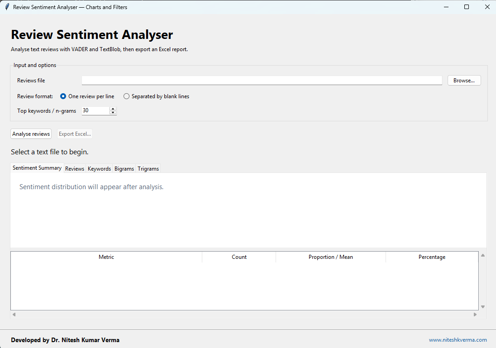

# Review Sentiment Analyser

A Python desktop application built with Tkinter for analysing English text reviews using VADER and TextBlob.

## Features

| Feature | What you can do |
| --- | --- |
| Sentiment overview | View positive, neutral, and negative review counts and percentages in the first tab, with a distribution chart. |
| Two sentiment methods | Inspect VADER negative, neutral, positive, and compound scores alongside TextBlob polarity and subjectivity. |
| Summary statistics | Examine the mean, median, and sample standard deviation of VADER compound scores and the average sentiment components. |
| Combined review filters | Select a sentiment class and combine it with case-insensitive text search to find relevant reviews. |
| Full-review inspection | Double-click a result to read the complete original review in a separate window. Original review numbers remain intact after filtering. |
| Flexible input | Read one review per non-empty line or multiline reviews separated by blank lines. |
| Encoding support | Load UTF-8 text, including files with a byte-order mark, with a Windows-1252 fallback. |
| Configurable keyword analysis | Choose how many top keywords, bigrams, and trigrams to report. |
| Review boundaries | Build n-grams within each review, avoiding phrases created by joining different reviewers' text. |
| Responsive desktop interface | Run analysis in a background thread with progress messages, leaving the Tkinter interface responsive. |
| Complete Excel export | Save six report sheets with summary measures, individual scores, keywords, and n-grams. Review text is stored as literal text. |
| Local analysis | Process input files on your computer. Internet access is needed to install packages and obtain missing NLTK resources. |

## Practical applications

For permitted noncommercial use, the app can support:

- **Library service evaluation:** inspect feedback about staff, facilities, collections, accessibility, and study environments.
- **Course and educational-video feedback:** explore comments about teaching quality, learning resources, and learner experiences.
- **Open-ended survey analysis:** summarise English-language responses and retrieve comments containing specific terms.
- **Public-comment research:** explore opinions in previously collected comments about policies, events, or public services.
- **Research reporting:** export review-level evidence for manual checking, tables, and further analysis in Excel.
- **Classroom demonstrations:** introduce sentiment scores, subjectivity, word frequencies, and n-gram analysis using a desktop interface.

The app analyses text files you provide. It does not scrape Google Maps or YouTube, fetch Google Trends data, translate text, forecast trends, or perform demographic or network analysis.

## Software preview



## Setup

Use Python 3.10 or newer with Tkinter available. On Windows, use a Python installation that includes Tcl/Tk.

```sh
python -m venv .venv
```

Activate the environment in Windows PowerShell:

```powershell
.venv\Scripts\Activate.ps1
```

Install dependencies and launch:

```sh
python -m pip install -r requirements.txt
python sentiment_gui.py
```

On the first analysis, the app downloads missing NLTK stopwords and VADER data, which requires internet access. Subsequent analyses use the downloaded resources.

## Usage

1. Browse to a text file of English reviews.
2. Choose one review per line or reviews separated by blank lines.
3. Select the number of top keywords and n-grams, then click **Analyse reviews**.
4. Explore the summary chart and use the Reviews tab to search or filter. Double-click a review to read its full text.
5. Click **Export Excel** to save the complete analysis. Review filters affect the displayed table; the chart and exported workbook cover the full dataset.

### Excel report contents

| Worksheet | Contents |
| --- | --- |
| Sentiment Summary | Review counts, proportions, percentages, compound-score statistics, and sentiment component averages. |
| Chart Data | Selected sentiment proportions and mean scores for creating charts. |
| Review-level Sentiment | Original review text, review number, VADER scores and classification, and TextBlob polarity and subjectivity. |
| Keywords | Ranked words and their frequencies after cleaning and stopword removal. |
| Bigrams | Two-word combinations ranked by NLTK's `mi_like` association score, with their occurrence counts. |
| Trigrams | Three-word combinations ranked by occurrence frequency. |

Search and sentiment filters affect the displayed review table only. The summary chart and exported workbook always describe the full input dataset.

### Preparing your input

For one review per line:

```text
The staff were helpful and the study space was excellent.
The room was noisy and the service was disappointing.
The library opens at nine in the morning.
```

For reviews separated by blank lines, each block becomes one review. Select the matching format before analysis. Review boundaries directly affect the counts and scores, so check that your file follows the selected format.

## Files

- `sentiment_gui.py`: recommended app, including chart and review filters.
- `input_data.txt`: sample reviews for trying the application.

A sample input file is included. Generated Excel reports and environment files are excluded from version control.

## How the analysis works

1. **Load and split:** `read_text_file()` and `split_reviews()` read the file and identify individual reviews.
2. **Prepare keyword text:** `clean_text_for_keywords()` lowercases text and removes digits and punctuation. English stopwords are removed; keywords are not lemmatised. N-grams are built from the remaining tokens within each review.
3. **Score original reviews:** `analyse_file()` uses original text for sentiment scoring, preserving punctuation and capitalisation cues for VADER.
4. **Classify and summarise:** `classify_vader()` applies standard compound-score thresholds; helper functions calculate descriptive statistics.
5. **Explore and export:** `draw_chart()`, `apply_filters()`, and `show_review()` support inspection; `export()` saves the full workbook.

### Interpreting the results

| Measure | Meaning |
| --- | --- |
| VADER compound | A normalised sentiment score from −1 to +1. Positive: score ≥ +0.05; Negative: score ≤ −0.05; otherwise Neutral. |
| VADER components | Negative, neutral, and positive proportions of the scored text. These differ from the percentages of reviews in each class. |
| TextBlob polarity | A sentiment score from −1 to +1. |
| TextBlob subjectivity | A score from 0 to 1, indicating more objective to more subjective language; it is not a confidence or accuracy score. |

Automated labels are estimates. Sarcasm, mixed opinions, domain-specific vocabulary, and non-English text may produce misleading results. Review a sample manually before drawing conclusions. The classification of the mean compound score is an aggregate interpretation, not the majority review label or a model-accuracy measure.

## Published research and analytical applications

The author identifies the following publications as research applications of the Python analysis tools and workflows underpinning this project. Some publications predate the current Tkinter release and describe earlier scripts or broader analytical workflows; this list does not imply that every study used this exact GUI version or that the app performs every method in those papers.

1. **Lal, A., & Verma, N. K. (2026).** [Library services in the age of digital feedback: A case study of Google Maps reviews of Uttar Pradesh’s district libraries](https://journals.sagepub.com/doi/10.1177/18758789261475625). *Information Services & Use*. DOI: `10.1177/18758789261475625`.  
   **Application:** public-library feedback, review sentiment, and recurring service themes.

2. **Verma, N. K., Saikia, S., & Verma, M. K. (2025).** [Sentiment Analysis of Users’ Comments on Budget Speeches by the Indian Finance Minister (2019–2023): A Data Mining Study based on YouTube Videos](https://lis.uok.edu.in/Files/9ebfb2f2-5003-47a4-9dfe-d3cdcc6a2020/Journal/6aeaae5e-9589-495b-aa1a-30bd95ca22a7.pdf). *Trends in Information Management*, 13(1), 45–60.  
   **Application:** public responses to budget speeches. The paper describes a Python workflow using NLTK, TextBlob, VADER, keyword analysis, and bigrams; its preprocessing differs from the present app.

3. **Verma, N. K., Verma, M. K., & Kushwaha, S. S. (2025).** [Evaluating the growth trends of MOOCs content on YouTube: a Google Trends and sentiment analysis](https://www.emerald.com/gkmc/article/doi/10.1108/GKMC-01-2025-0024/1300953/Evaluating-the-growth-trends-of-MOOCs-content-on). *Global Knowledge, Memory and Communication*. DOI: `10.1108/GKMC-01-2025-0024`.  
   **Application:** MOOC-related comments and educational engagement. The study reports NLTK, TextBlob, and VADER analysis alongside separate Google Trends and video-metadata analysis.

4. **Verma, N. K., Yadav, S. K., & Verma, M. K. (2024).** [Exploring Online Community Search Interest on Temporal Dynamics of Ayodhya: A Case Study of the Ram Mandir based on Google Search Trends Insight](https://or.niscpr.res.in/index.php/ALIS/article/view/10117). *Annals of Library and Information Studies*, 71(3), 331–340. DOI: `10.56042/alis.v71i3.10117`.  
   **Related analytical work:** search-interest trends, related queries, and forecasting. Its published abstract does not establish use of this sentiment-analysis app; Google Trends collection and forecasting are outside the app's features.

5. **Verma, N. K., Nazim, Mohd, & Verma, M. K. (2023).** [Unveiled Public Sentiments on Balasore (India) Train Tragedy: An analysis based on YouTube videos’ comments](https://indianjournals.com/article/wdl-16-2-003). *World Digital Libraries*, 16(2), 97–118.  
   **Application:** public sentiment expressed through YouTube comments, with a broader study of video content and engagement.

For the methods and findings of each study, consult the linked publication. Cite the relevant paper when discussing its findings and cite this software separately when using the app.

## Credits

Developed by **Dr. Nitesh Kumar Verma**.  
Website: [www.niteshkverma.com](https://www.niteshkverma.com)

## License and permitted use

Copyright (c) 2026 Dr. Nitesh Kumar Verma.

This project is provided under the custom [Noncommercial Use and Redistribution License](LICENSE).

- Free to use for noncommercial purposes.
- Free to redistribute unmodified copies without charge, retaining the license, citation file, copyright notice, and author credits.
- Commercial use and paid redistribution are prohibited without separate written permission.
- Modification and redistribution of modified versions are not licensed; contact the author for permission.
- Academic and research use requires author acknowledgment and a software citation in resulting scholarly outputs.

These are custom source-available terms, not the MIT License. Third-party dependencies retain their own licenses. Consult [LICENSE](LICENSE) for the full terms.

## Required academic citation

If you use this software in academic or research work, you must credit **Dr. Nitesh Kumar Verma** and cite **Review Sentiment Analyser** in the resulting publication, thesis, report, presentation, or other scholarly output, as required by the license.

Suggested citation:

> Verma, N. K. (2026). *Review Sentiment Analyser* [Computer software]. https://www.niteshkverma.com/review-sentiment-analyser/index.html

Use the metadata in [CITATION.cff](CITATION.cff) for citation tools. On GitHub, place this file in the repository root on the default branch to enable **Cite this repository**. The citation metadata includes the [GitHub repository](https://github.com/vermanite/review-sentiment-analyser). Add an archived-release DOI if one becomes available.

Suggested acknowledgment:

> Review sentiment analysis was conducted using Review Sentiment Analyser, developed by Dr. Nitesh Kumar Verma.
